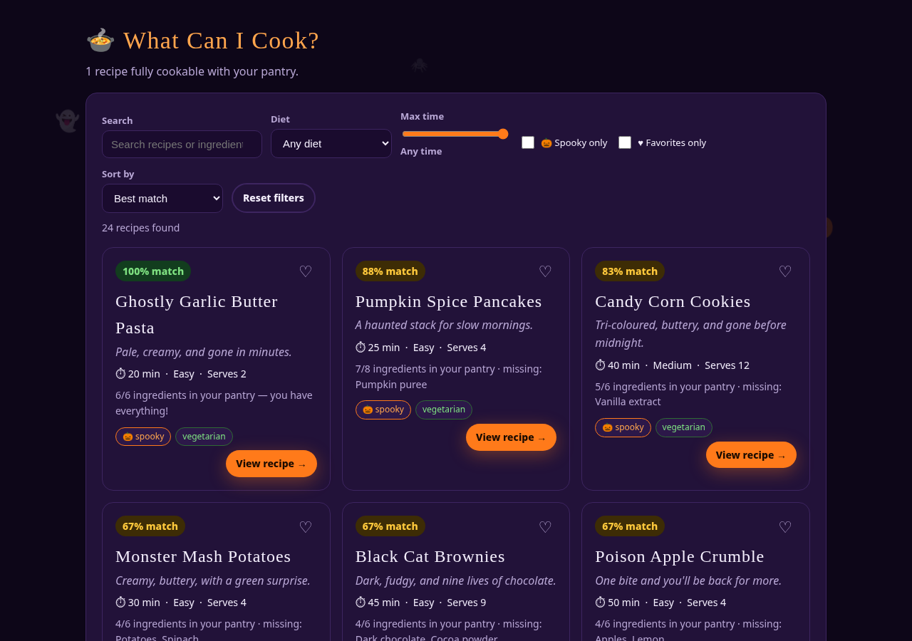

# 👻 Pantry Phantom

**What can I cook tonight with the food I already have?**

Pantry Phantom is a free, no-sign-up web app that matches **24 real recipes**
against the ingredients already in your kitchen — with a haunted Halloween
twist. Tell the Phantom what's in your pantry, and it shows a match percentage
for every recipe, exactly which ingredients you're missing, and collects the
missing ones into a shopping list.

Built for **Kiroween 2026** (Costume Contest) by **GEMMA WORKS**.



## Try it

No install, no account. Open `index.html` in a browser, or serve the folder:

```bash
python3 -m http.server 8321
# open http://localhost:8321
```

Or deploy the folder to any static host (GitHub Pages, Netlify, nginx).

## Features

- 🧺 **Pantry** — type ingredients (with live suggestions) or tap quick-add
  chips grouped by aisle. Saved in your browser, survives reloads.
- 🔍 **Live matching** — every recipe shows a match %; 100% matches glow green.
- 🍲 **24 real recipes** — Witch's Brew Pumpkin Soup, Mummy Dogs, Ghostly Garlic
  Butter Pasta, Black Cat Brownies… Halloween names, genuinely cookable food.
- 🎛️ **Filters** — search, diet (vegetarian / vegan / gluten-free), max time,
  spooky-only, favourites-only, sort by match / quickest / A–Z.
- 📖 **Recipe detail** — ingredients with have/missing marks, numbered steps.
- 🛒 **Shopping list** — one tap adds a recipe's missing ingredients; check
  items off, copy the list, clear it.
- 🔮 **Summon a recipe** — a random pick, preferring recipes you can mostly cook.
- ♥ **Favourites** — saved in your browser.
- 🕷️ **Halloween UI** — dark haunted-kitchen theme, floating ghosts, pumpkin orange.

## Privacy

Your pantry, favourites, and shopping list are stored **only in your browser**
(`localStorage`). Nothing is sent to any server. No account, no tracking, no ads.

## How it was built (Kiro)

This project was built spec-first, following Kiro's workflow:

- **Specs** — `.kiro/specs/pantry-phantom/` holds `requirements.md` (EARS
  acceptance criteria), `design.md` (architecture + decisions), and `tasks.md`
  (implementation plan + verification log).
- **Steering** — `.kiro/steering/` holds `product.md`, `tech.md`, `structure.md`.
- **Hooks** — `.kiro/hooks/` holds two v1-schema hooks (per
  [kiro.dev/docs/hooks](https://kiro.dev/docs/hooks/)): syntax check on save and
  recipe validation on save.

See **[KIRO_USAGE.md](KIRO_USAGE.md)** for the honest, detailed write-up of
exactly what was done with Kiro — including what still needs a signed-in Kiro
session. TL;DR: Kiro CLI 3.4.0 was installed and verified on Linux
(`kiro-cli --version`, `whoami` → "Not logged in"); the interactive Kiro agent
could not run in this environment because authentication needs a browser OAuth
sign-in with an AWS Builder ID, which is a BLOCKED step for the project owner
(see [BLOCKED.md](BLOCKED.md)). The spec/steering/hook artefacts were authored
in Kiro's real formats and validated against the official docs.

## Verify it yourself

```bash
node --check recipes.js && node --check app.js   # syntax
node scripts/validate-recipes.js                # recipe data integrity
python3 dev/test-app.py                         # Playwright e2e + screenshots
```

The Playwright run (18 Nov 2026) passed with 0 page errors: empty pantry →
demo pantry (16 items, 1 fully cookable) → recipe modal at 88% → shopping list
+1 → vegetarian filter (17 recipes) → search "pumpkin" (2 recipes) → summon.
Screenshots: `dev/screenshots/`.

## Tech

Vanilla HTML + CSS + JavaScript. No framework, no bundler, no backend, no
runtime dependencies. The only external request is the optional Google Fonts
stylesheet (Creepster display font) with a system-font fallback.

## License

MIT — see [LICENSE](LICENSE).
